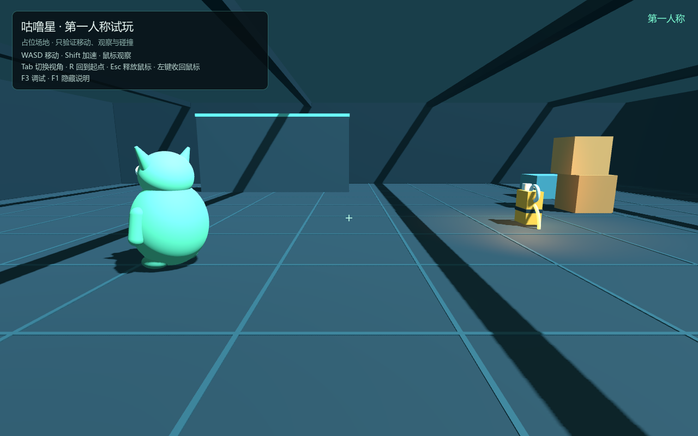

# 咕噜星 · 第一人称试玩预览

《迷失太空 / Lost in Space》第四个星球“咕噜星”的独立试玩预览。

本轮只验证**第一人称移动、鼠标观察、视角切换与场景碰撞**；场上有一只占位咕噜和一块占位燃料，
**没有任何发现、追逐、叼走、声音或联网行为**。



## 启动

用 Godot **4.7.2** 打开本目录的 `project.godot`，或：

```powershell
& "<Godot 4.7.2 可执行文件>" --path "<仓库>/game/previews/gulu_planet"
```

入口场景：`gulu_planet.tscn`。进入即为**第一人称**，鼠标会被捕获。

### 操作

- **WASD**：移动
- **Shift**：加速
- **鼠标**：环视
- **Tab**：切换第一人称 / 第三人称（第三人称仅用于检查角色）
- **R**：回到出生点
- **Esc**：释放鼠标
- **左键**：重新捕获鼠标
- **F3**：开关调试面板
- **F1**：隐藏/显示左上操作说明

## 复用来源

控制器**逐字复制**自 GitHub `main` 提交 `42519ff403241bf5ac968edb9ae326c6fdbc74fe`：

- `game/previews/resonance_coop_playtest_01_1/scripts/station_player.gd`
- 与 `game/previews/resonance_02_quality_rework/scripts/station_player.gd` 完全相同
  （SHA256 `16ADB4AFB5CAE2AB151C870828D9FCA27EBF28BA1ADD30F12072510A67BE399E`）

同时复制其依赖：

- `scripts/camera_guard.gd`
- `scripts/interaction_pose.gd`
- `scripts/protagonist_visual.gd`
- `scenes/protagonist_visual.tscn`
- `contact_shadow.gdshader`
- `assets/characters/protagonist_model.json`
- `assets/characters/skins/skin_ranger.glb`

没有复制共振星 67 MB 的空间站模型；本轮用自建灰盒场地。没有修改 `station_player.gd`。

### 保留的视角/移动参数

| 项目 | 值 |
| --- | --- |
| 移动速度 | 5.8 m/s |
| Shift 倍率 | 1.65 |
| 第一人称眼睛高度 | 1.65 m |
| FOV | 62° |
| 鼠标灵敏度 | 0.0024 |
| 俯仰限制 | −0.58 … +0.30 rad |
| 视角切换 | Tab（`inspect_first_person`） |

原预览默认第三人称；本预览在生成玩家后设置 `use_first_person=true`，因此进入即为第一人称。
Tab 仍可切回第三人称查看角色和场地。

## 场景

- 32×26 m 灰盒场地，地板/舱壁/横梁/箱子/低台/一道碰撞验证墙。
- 出生点 `(-8, 0.02, 0)`，默认朝 +X；占位咕噜在左前方，占位燃料在右前方，进入首屏即可看到。
- 占位咕噜：绿色圆润身体、眼睛、耳朵、手臂、脚；静态。
- 占位燃料：橙色燃料罐 + 地面光环 + 暖光；静态，无交互。
- 无漂浮 3D 文字；HUD 只有操作说明、当前视角和 F3 调试。

## 实际验证（自动运行）

```powershell
& $godot --path $preview -- --selftest
# GULU SELFTEST SUMMARY passes=16 failures=0

& $godot --headless --path $preview -- --selftest
# GULU SELFTEST SUMMARY passes=14 failures=0（headless 跳过鼠标观察）
```

已验证：默认第一人称、眼睛高度 1.65 m、FOV 62°、W 前进 5.22 m、鼠标 yaw、
俯仰 clamp、内墙碰撞停在 x=11.32、Tab 双向切换、R 重置、F3 调试、两只占位对象首屏可见。

**尚未验证**：真人手动试玩的手感；跳跃（复用的控制器本身没有跳跃）；咕噜行为；麦克风；
联网同步。详见 `TESTING.md`。

## 本轮范围

**做**：预览工程、第一人称接入、灰盒场地、占位咕噜/燃料、移动/观察/碰撞验证、重置、文档。

**不做**：发现/追逐、声音吸引、叼走/吞掉/抢回燃料、攻击/伤害、任务结算、正式航线接入、
麦克风系统、联网扩展、正式模型/动画。

## 目录

```
gulu_planet/
├─ project.godot
├─ gulu_planet.tscn
├─ scripts/
│  ├─ station_player.gd      # 复用，逐字未改
│  ├─ camera_guard.gd        # 复用
│  ├─ interaction_pose.gd    # 复用
│  ├─ protagonist_visual.gd  # 复用
│  ├─ gulu_app.gd            # 入口/场地/输入/HUD/自测
│  ├─ placeholder_gulu.gd
│  └─ fuel_prop.gd
├─ scenes/protagonist_visual.tscn
├─ assets/characters/...
├─ docs/screenshots/
├─ BRIEF.md / STATUS.md / DECISIONS.md / TESTING.md
```

## 已知限制

- 本地 `origin/main` 仍是旧 2D `3969511`；GitHub 当前 main 是 3D `42519ff`。
  `git fetch` 连接被重置，本轮分支基于旧本地 main，预览文件从 42519ff raw 复制且自包含；
  网络恢复后应 rebase 到最新 main。
- 第三人称只用于检查；镜头被限制在灰盒内，靠近角色时可能隐藏身体（沿用原预览行为）。
- 控制器没有跳跃；本轮不另写一套。
- 未接入正式星球选择、航线和主线。
